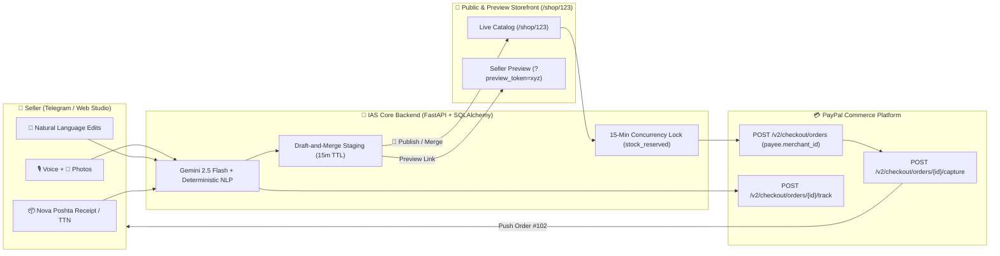

# ⚡ Instant AI Storefront (IAS)

<div align="center">


**Mobile-First & Zero-Form AI E-Commerce Platform for Social Sellers (Instagram, TikTok, Telegram)**  
*Turn unstructured voice notes and product photos into an instant, concurrency-safe PayPal Checkout storefront — without filling out a single form.*

</div>

---

## 🌟 1. Concept & Core Philosophy (Концепція та філософія)

**Instant AI Storefront (IAS)** eliminates the #1 barrier for micro-merchants on Instagram, TikTok, and Telegram: tedious admin dashboards and manual catalog forms. Instead of typing SKU tables, a seller simply forwards photos and a 5-second voice note to the **IAS Telegram Bot**, reviews a safe staging preview, and starts accepting **1-click PayPal Native Checkout** payments immediately.

### Four Architectural Pillars:
1. **Zero-Form Ingestion:** Sellers never fill out text fields or forms manually. Multimodal AI (Voice + Photo + Natural Language) structures everything automatically.
2. **Draft-and-Merge Pattern:** No AI action ever mutates the live catalog without explicit seller confirmation in Telegram (`[🚀 Опублікувати]` / `[✅ Застосувати]` vs `[❌ Скасувати]`).
3. **Strict Fact Extracting (Zero Hallucination Policy):** AI never fabricates fabric composition (e.g., *"100% cotton"*), brand names, or country of origin if not stated by the seller. Unmentioned attributes remain strictly `null`.
4. **PayPal Native Checkout & Partner Referrals:** Buyers pay in 1 click via PayPal Sandbox (`/v2/checkout/orders` routed directly to the seller's `payee.merchant_id`), backed by a **15-minute inventory reservation lock** against overselling and automatic **PayPal Add Tracking API** (`/v2/checkout/orders/{id}/track`) synchronization.

---

## 🏗 2. System Architecture & Workflows



---

## 🎯 3. All 5 Interactive Scenarios & Edge Cases Implemented

Our application includes a **Split-Screen Hackathon Demo Studio** at `/shop/123` where judges can test both the **Public/Preview Storefront** and the **Interactive Telegram Bot Simulator** side-by-side in 1 click:

| # | Scenario | Seller / Buyer Action | System & PayPal Reaction |
|---|---|---|---|
| **1** | **Create New Product (Happy Path)** | Seller sends 2 photos + voice: *«Зелена кофта, м'яка, є розміри S і M, ціна 40 баксів, залишків по 3 штуки кожного»* | AI creates `Draft` (`Green Soft Hoodie`, `$40.00`, `S: 3, M: 3`, unmentioned attributes `null`). Seller previews & clicks `[🚀 Опублікувати]` -> live on `/shop/123`. |
| **2** | **Natural Language Bulk Edit** | Seller says: *«Знизь ціну на всі літні сукні на 10%, але чорну сукню залиш по старій ціні. І розмір S для синьої сукні познач як випроданий»* | Generates a `BULK_EDIT` Draft & Telegram Diff (`$50 ➔ $45`, `$60 ➔ $54`, Black Dress `$70` unchanged, Blue Dress Size `S` Out of stock). Preview shows yellow diff badges. |
| **3** | **Purchase & 15-Min Concurrency Lock** | 1 pair of Sneakers (Size 43) left (`$80`). **Buyer A** clicks *Pay with PayPal*. **Buyer B** tries to buy Size 43 simultaneously. | Backend sets `stock_reserved = 1` for 15 mins. Buyer B sees *"⏳ Товар зарезервовано іншим покупцем"*. When Buyer A captures payment, Order `#102` is created & pushed to Seller's Telegram. |
| **4** | **Fulfillment & PayPal Tracking API** | Seller sends receipt photo or writes: *«Замовлення #102 відправив, трек Нової Пошти 20450012345678»* | AI extracts `#102` and `20450012345678`, calls **PayPal Add Tracking API** (`/v2/checkout/orders/{id}/track`), notifies buyer, and confirms in Telegram. |
| **5** | **Cancellation, Rollback & Noise Safety** | Seller sends a personal cat photo or clicks `[❌ Скасувати]` on a draft. | Non-commercial input is politely rejected; cancelled draft invalidates `preview_token` leaving the live store untouched. |
| **Edge A1** | **Missing Price Warning** | Seller says: *«Червона сукня, розміри S і M»* (no price). | Draft created with `price = 0.00`, warning banner *"⚠️ Увага: Ціну не вказано!"*, and publish button locked until price is set. |
| **Edge A2** | **Surzhyk & Currency Mismatch** | Seller says: *«Червона сукня, розміри S і M, ціна двісті грн»* in a `USD` store. | AI converts `200 UAH` ➔ `$5.00 USD` and prompts with buttons: set `$5.00 USD` or switch shop currency to `UAH`. |
| **Edge B** | **Preview Token Security** | Opening `/shop/123?preview_token=xyz` | Enforces 15-minute TTL, injects `<meta name="robots" content="noindex, nofollow">`, and displays a fixed *"Режим перегляду продавця"* top bar. |

---

## 🚀 4. Quickstart (Швидкий запуск)

### 1. Clone & Install Dependencies
```bash
git clone https://github.com/DietaryMage868/IAS.git
cd IAS
pip install -r requirements.txt
```

### 2. Configure Environment (Optional — Works Out-of-the-Box!)
The platform works **100% out-of-the-box** using the built-in Smart Deterministic NLP Engine and Interactive PayPal Sandbox Simulator. To connect live keys, copy `.env.example` to `.env` (or paste keys directly in the Web UI **⚙️ PayPal OAuth & Keys** modal):
```bash
cp .env.example .env
```

### 3. Run the Server
```bash
uvicorn app.main:app --reload --port 8000
```
Open **`http://localhost:8000/shop/123`** in your browser!

### 4. Run Automated Test Suite (Pytest)
```bash
pytest -v
```

---

## 📂 5. Project Structure

```text
IAS/
├── app/
│   ├── main.py                 # FastAPI application, routes, and background 15-min lock cleaner
│   ├── config.py               # Environment & runtime settings
│   ├── database.py             # SQLAlchemy engine & session management
│   ├── models.py               # Shop, Product, ProductVariant, Draft, Reservation, Order, BotMessage
│   ├── schemas.py              # Pydantic validation & Strict Fact Extraction schemas
│   ├── bot/
│   │   └── telegram_bot.py     # Real Aiogram 3.x Telegram Bot polling handler
│   ├── services/
│   │   ├── ai_engine.py        # Gemini 2.5 Flash Multimodal + Ukrainian/Surzhyk NLP Engine
│   │   ├── bot_orchestrator.py # Unified pipeline for Telegram Bot & Web Studio
│   │   ├── draft_service.py    # Draft-and-Merge staging, 15m preview_token, atomic merge
│   │   ├── inventory.py        # 15-minute stock reservation lock & concurrency protection
│   │   ├── paypal_service.py   # PayPal Orders v2, payee.merchant_id, Add Tracking API
│   │   └── seed.py             # Initial catalog seed for Shop #123
│   ├── static/assets/          # Product & receipt SVG illustrations
│   └── templates/shop.html     # Split-screen Storefront + Interactive Telegram Studio UI
├── tests/
│   └── test_scenarios.py       # End-to-end automated tests for Scenarios 1–5 & Edge Cases A–D
├── Dockerfile                  # Container build configuration
├── render.yaml                 # 1-click Render.com Blueprint deployment
└── requirements.txt
```

---

## 📄 License

Distributed under the **MIT License**. See [`LICENSE`](LICENSE) for details.
